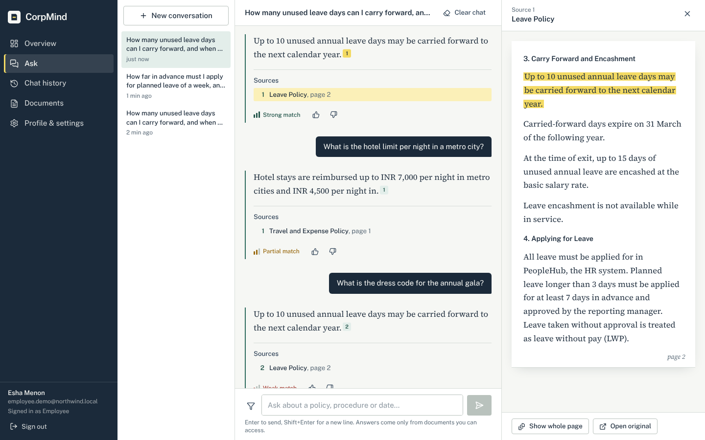

# CorpMind AI: enterprise knowledge assistant

CorpMind lets employees ask questions about internal company documents in plain language and get answers
that cite the exact document and page. It only answers from documents the person's role is allowed to read,
and when the documents don't cover a question, it says so instead of guessing.

**Stack:** React · FastAPI · LangChain · Hugging Face sentence-transformers · ChromaDB · PostgreSQL ·
PyPDF / python-docx



## Features

- **Answers with citations.** Every claim carries a footnote number. Clicking it opens the source page with
  the supporting sentence highlighted.
- **Never makes things up.** If nothing relevant is found, or the model's answer has no valid citation, the
  reply is exactly: *"I couldn't find sufficient information in the available company documents to answer this
  question."*
- **Role-based access, enforced during search.** Admin, HR and Employee roles, with per-category read
  permissions. They are applied inside both the vector search and the keyword search, and re-checked in the
  database before any text reaches the LLM.
- **Hybrid search.** Semantic search (ChromaDB) plus keyword search (PostgreSQL full-text), combined with
  Reciprocal Rank Fusion, then a cross-encoder reranker and a relevance threshold.
- **Conversations.** Follow-up questions, document summaries, policy comparisons, filters by category and date,
  chat history, thumbs up/down feedback, and a match-strength indicator.
- **Document management.** Multi-file upload (PDF, DOCX, TXT, CSV), page numbers preserved, duplicate detection,
  versions with roll-back, and deletion that also removes the search index entries.
- **Prompt-injection defense.** Hidden instructions in uploaded documents are flagged for admins, document text
  is fenced off as untrusted data in the prompt, and links and images are stripped from answers.
- **Admin panel.** Users and roles, a tickbox grid of which role can read which category, usage and quality
  analytics, answer feedback review, and an audit log.
- **Evaluation.** Precision@K, Recall@K, MRR, answer correctness, citation precision, faithfulness, answer
  relevance, latency, leak and injection checks, plus a threshold sweep, on a 31-question dataset.

## Repository layout

```
corpmind/
├── backend/                   FastAPI app, RAG pipeline, migrations, tests, evaluation, sample documents
├── frontend/                  React app (Vite), nginx config for production
├── docs/
│   ├── MODULES.md             how each part works and why, module by module
│   ├── API.md                 API reference (generated from the code) and auth/error guide
│   ├── REQUIREMENTS.md        each project requirement, where it's implemented, and how it's verified
│   └── screenshots/
├── docker-compose.yml         PostgreSQL only, for local development
└── docker-compose.prod.yml    full stack: PostgreSQL + backend + frontend
```

## Running it locally

These steps are written for **Windows** (PowerShell, for example the terminal inside VS Code).
On macOS or Linux, the differences are noted in brackets.

### 1. Install the prerequisites

| Tool | Where | Check it's installed |
|---|---|---|
| Python 3.11 or newer | python.org (tick **Add Python to PATH**) | `python --version` |
| Node.js 20 or newer (LTS) | nodejs.org | `node --version` |
| PostgreSQL 16 or 17 | postgresql.org/download (write down the `postgres` password you choose) | listed in the Start menu as *SQL Shell (psql)* |
| An LLM API key | **Groq** is free: console.groq.com → API Keys (starts with `gsk_`) | |

Docker is optional. If you have it, `docker compose up -d` in the project folder starts a ready-made
PostgreSQL instead of installing one (skip step 2 in that case).

### 2. Create the database

Open **SQL Shell (psql)**, press Enter at each prompt, and enter your `postgres` password. Then run:

```sql
CREATE USER corpmind WITH PASSWORD 'corpmind_dev' CREATEDB;
CREATE DATABASE corpmind OWNER corpmind;
CREATE DATABASE corpmind_test OWNER corpmind;
\q
```

### 3. Set up the backend

```powershell
cd backend
python -m venv .venv
.venv\Scripts\activate                   # [macOS/Linux: source .venv/bin/activate]
pip install torch --index-url https://download.pytorch.org/whl/cpu
pip install -r requirements.txt
copy .env.example .env                   # [macOS/Linux: cp .env.example .env]
python -c "import secrets; print(secrets.token_urlsafe(48))"
```

If PowerShell says running scripts is disabled, run `Set-ExecutionPolicy -Scope CurrentUser RemoteSigned` once.

Open `backend/.env` and change only these lines:

```
JWT_SECRET_KEY=<paste the long random string printed above>
LLM_PROVIDER=groq
LLM_MODEL=openai/gpt-oss-120b
LLM_API_KEY=<your gsk_ key>
```

Leave `DATABASE_URL` as it is. Lines starting with `#` are comments and can be ignored.

Then prepare the database, models and accounts:

```powershell
alembic upgrade head                                      # tables + default categories
python -m app.scripts.download_models                     # search models, ~200 MB, once
python -m app.scripts.create_admin --email you@example.com   # asks you to choose a password
python -m app.scripts.seed_sample_data                    # optional: sample documents + demo users
```

### 4. Run

Two terminals:

```powershell
# Terminal 1
cd backend
.venv\Scripts\activate
uvicorn app.main:app --reload            # API on :8000, interactive docs at http://localhost:8000/docs
```

```powershell
# Terminal 2
cd frontend
npm install                              # first time only
npm run dev
```

Open **http://localhost:5173** and sign in with your admin account. To stop, press **Ctrl+C** in both
terminals. After you change `backend/.env`, restart the backend for the change to take effect.

## Choosing an LLM

Change three lines in `backend/.env`, then restart the backend.

| Provider | `LLM_PROVIDER` | Example `LLM_MODEL` | Notes |
|---|---|---|---|
| **Groq** (recommended, free) | `groq` | `openai/gpt-oss-120b` | Free tier with rate limits. Model names change, so pick a current one from the Groq console if you get `model_not_found` |
| OpenAI | `openai` | `gpt-4o-mini` | Key starts with `sk-`; the account needs credit |
| Anthropic | `anthropic` | `claude-haiku-5-5` | Paid |
| Google Gemini | `google_genai` | name from Google AI Studio | `pip install langchain-google-genai`. Free tier data may be used by Google, so use sample documents only |
| Ollama (local, offline) | `ollama` | `llama3.1` | `pip install langchain-ollama`, no key. Needs a powerful computer |

Test the LLM on its own with:

```powershell
python -c "from app.services.llm import get_llm; print(get_llm().invoke('Say hello').content)"
```

## Sample data and demo accounts

`backend/sample_docs/` contains 13 documents for a **fictional** company, Northwind Analytics, across six
categories and all four formats. They include confidential documents (salary bands for HR, a board brief for
Admin only) and one file with a deliberately planted prompt-injection line. `versions/Leave Policy.pdf` is an
updated policy for demonstrating versioning; upload it yourself.

`seed_sample_data` creates two demo accounts sharing the password you choose:
`hr.demo@northwind.local` (HR) and `employee.demo@northwind.local` (Employee).

Questions to try:

| Ask as | Question | Expected |
|---|---|---|
| Employee | How many unused leave days can I carry forward? | 10 days, expiring 31 March, citing Leave Policy page 2 |
| Employee | Compare the leave and remote work policies on probation | A comparison table citing both documents |
| Employee | What is the salary range for grade L4? | Refused: Employees can't read HR Confidential |
| HR | What is the salary range for grade L4? | 22 to 32 lakh, citing Compensation Bands 2026 |
| Admin | Are vendor payments pre-approved? | Needs a purchase order; the planted instruction is ignored |

## Tests and evaluation

```powershell
cd backend
pytest                                                # 97 tests, uses the corpmind_test database
python -m evaluation.run --retrieval-only --sweep     # search quality + threshold tuning, no LLM needed
python -m evaluation.run                              # full evaluation with your LLM
```

The tests use a small offline embedder and a scripted LLM, so they run without internet or API keys.
Evaluation reports are saved to `backend/evaluation/reports/`.

## Troubleshooting

| Problem | Fix |
|---|---|
| `password authentication failed for user "corpmind"` | The database user is missing or has another password. In SQL Shell run `ALTER USER corpmind WITH PASSWORD 'corpmind_dev';` (or the `CREATE USER` command from step 2) |
| Forgot the `postgres` password | In `C:\Program Files\PostgreSQL\<version>\data\pg_hba.conf`, change the two `host all all` lines to `trust`, restart the postgresql service in `services.msc`, set a new password in SQL Shell, then change the lines back to `scram-sha-256` and restart again |
| PostgreSQL service "started and then stopped" | A typo in `pg_hba.conf`. The newest file in the `data\log` folder names the line |
| "The language model is currently unavailable" | Run the LLM test command above. `401` means a wrong key or the wrong provider for that key. `404 model_not_found` means the model name has been retired |
| Every answer is "I couldn't find sufficient information…" | Check that documents show **Ready** on the Documents page. If they show **Failed**, run `download_models` and then `seed_sample_data` again |
| A document is flagged "Contains text that looks like instructions to an AI" | Expected for `Vendor Portal Notes` (it's a demonstration). For real documents, review the quoted excerpt |
| Signed out on every reload, or the API can't be reached | Use http://localhost:5173 (not :8000) and make sure the backend is running |

## Deploying

`docker-compose.prod.yml` runs PostgreSQL, the backend and an nginx frontend together:

```bash
cp backend/.env.example backend/.env      # fill in JWT_SECRET_KEY and the LLM settings
cp .env.example .env                       # set POSTGRES_PASSWORD
docker compose -f docker-compose.prod.yml up -d --build
docker compose -f docker-compose.prod.yml exec backend python -m app.scripts.create_admin --email you@example.com
```

The site is then on port 8080. The server needs at least 2 GB of RAM (4 GB recommended) for the search models.
Before putting it on the internet:

- Serve it over **HTTPS** and set `COOKIE_SECURE=true`.
- Set `ALLOW_SELF_REGISTRATION=false`, or `REGISTRATION_EMAIL_DOMAINS` to your organisation's email domain.
- Use new, strong passwords.
- Back up the `pgdata` and `storage` volumes together.

## Security

Argon2id password hashing · short-lived access tokens kept in memory · rotating refresh tokens in an httpOnly,
`SameSite=Strict` cookie with reuse detection · roles re-checked on every request · category access enforced
inside retrieval with a database re-check · 404 instead of 403 for hidden resources · upload checks by file
content (magic bytes, zip-bomb and macro checks) · rate limiting · audit log · secrets only in environment
variables, with log redaction · no document text in ChromaDB or the logs · prompt-injection flagging, fencing
and output sanitising · Content-Security-Policy and security headers · a test that fails if any endpoint
accidentally becomes public.

**Never commit `backend/.env`.** It holds your API key and secret key, and `.gitignore` already excludes it.
If a key is ever pushed by mistake, delete it at the provider and create a new one.

## Known limitations

- Scanned PDFs (images only) are not supported; there's no OCR.
- Keyword search is English-only.
- Prompt-injection detection is heuristic. The main protection is how document text is handled in the prompt.
- Accounts are local; there's no single sign-on.
- The backend runs a single worker, which suits a department-sized deployment.

## Documentation

- [`docs/MODULES.md`](docs/MODULES.md): how each module works and why.
- [`docs/API.md`](docs/API.md): the API reference. Regenerate it with `python -m app.scripts.gen_api_docs`.
  Live interactive docs are at http://localhost:8000/docs.
- [`docs/REQUIREMENTS.md`](docs/REQUIREMENTS.md): each project requirement and how it's met.
